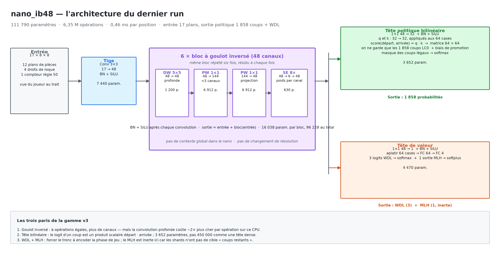
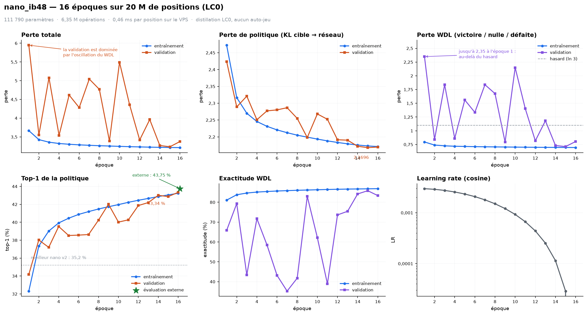
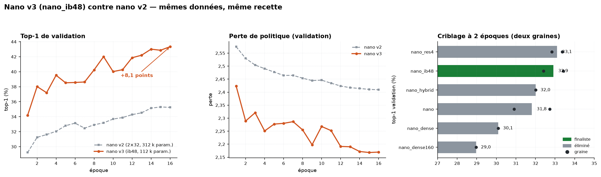
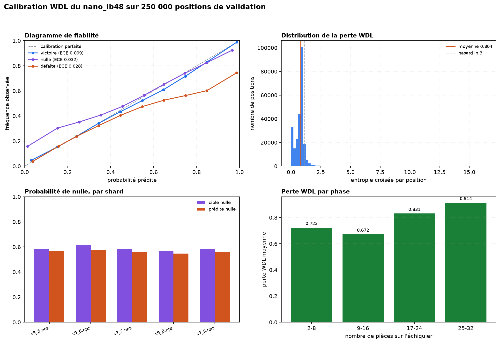

# Run nano_ib48 — 16 époques, 20 M de positions

Dernier entraînement complet de la gamme v3, les 26 novembre 2025 sur une L4 Runpod
(EU-RO-1), pour **1,90 $** et **2 h 30**. C'est ce réseau qui est aujourd'hui en production.

| | |
|---|---|
| Modèle | `nano_ib48` (gamme v3), 111 790 paramètres, 6,35 M opérations |
| Données | 400 shards LC0 T80 × 50 000 positions = 20 M, 395 train / 5 validation (250 k) |
| Recette | 16 époques, batch 4096, AdamW, LR 3e-3 cosine → 0, AMP, 320 M exemples vus |
| Durée | 559–597 s par époque, 2 h 30, 1,90 $ |
| Sortie | `best.pt` (époque 15), `last.pt` (époque 16) ; c'est `last.pt` qui a été exporté |
| Évaluation externe | 43,75 % de top-1, 82,86 % d'exactitude WDL sur 50 000 positions |
| Duel | 77,5 % contre la production, +215 Elo [+169 ; +268], 1,81× plus de nœuds |

Le fichier `history.jsonl` n'était pas versionné (le pod a été détruit) ; il a été récupéré
depuis le volume Runpod `debzero-shards` le 27/11 et est désormais dans
`docs/mesures/nano_ib48_history.jsonl`.



## L'architecture, couche par couche

L'entrée est **17 plans 8×8 en NHWC**, toujours du point de vue du joueur au trait : 6 plans
de pièces alliées, 6 plans de pièces adverses, 4 plans de droits de roque, 1 plan de
compteur de la règle des 50 coups (normalisé 0–255). Pas de plan de prise en passant : elle
est absente des données LC0. Pas de plan « trait aux blancs » : le plateau est retourné
quand les noirs jouent, le réseau ne voit qu'un seul côté.

| Étage | Détail | Paramètres | MAC |
|---|---|---:|---:|
| Tige | Conv 3×3, 17 → 48, BN, SiLU | 7 440 | 0,47 M |
| 6 × bloc IB | DW 5×5 48 (groups=48), BN, SiLU ; PW 1×1 48 → 144, BN, SiLU ; PW 1×1 144 → 48 ; SE 48 → 6 → 48 ; résidu | 16 038 / bloc, 96 228 | ~1,0 M / bloc |
| Tête politique | 1×1 48 → 32, BN, SiLU ; q et k : 32 → 32 par case ; scores 64 × 64 ; gather des 1 858 coups LC0 ; biais de promotion ; masque légal ; softmax | 3 652 | 0,36 M |
| Tête de valeur | 1×1 48 → 1, BN, SiLU ; aplatir 64 ; FC 64 → 64 ; FC 64 → 4 ; WDL(3) softmax + MLH(1) softplus | 4 470 | 0,007 M |
| **Total** | | **111 790** | **6,35 M** |

Trois choix structurent la gamme :

1. **Bloc à goulot inversé.** La convolution profonde 5×5 coûte peu d'opérations, puis les
   deux 1×1 élargissent à 144 canaux avant de projeter à 48. À budget d'opérations égal, le
   tronc porte plus de canaux qu'une pile de convolutions 3×3 classiques. Contrepartie
   mesurée : sur ce CPU, la convolution profonde coûte environ **2× plus de temps par
   opération** qu'une convolution classique — d'où l'importance de mesurer en millisecondes
   et pas seulement en MAC.
2. **Tête politique bilinéaire.** Le logit d'un coup est le produit scalaire entre un vecteur
   `q` de sa case de départ et un vecteur `k` de sa case d'arrivée, plus un biais de
   promotion. Le réseau apprend des relations entre cases, pas un index de coup, et la tête
   ne pèse que 3 652 paramètres. Les têtes denses équivalentes, à budget d'opérations
   comparable, font **1 à 4 points de top-1 de moins** et grossissent jusqu'à 707 k
   paramètres pour rien.
3. **WDL + MLH.** La seconde sortie force le tronc à encoder la phase de la partie. Le MLH
   (« nombre de coups restants ») est **inerte** ici : les shards n'ont pas cette cible, la
   sortie est donc présente dans le contrat ONNX mais jamais apprise.

Le contrat de sortie est `policy` (1 858), `wdl` (3), `mlh` (1). Le moteur ignore `mlh`.

### Ce que « 6,35 M » veut dire

C'est le chiffre du compteur du projet (`bench/bench_arch.py`). Ce compteur intercepte les
`Conv2d` et les `Linear` mais ne compte pas le produit matriciel `q @ kᵀ` (131 k MAC) et
sous-compte les deux couches `q`/`k` appliquées aux 64 cases (2 × 64 k). Le coût
arithmétique réel est donc plutôt **~6,8 M MAC**. L'ordre de grandeur et toutes les
comparaisons de la gamme restent valables ; c'est le chiffre 6,35 M qui est utilisé partout
dans les documents.

## La recette d'entraînement

- **Données** : distillation LC0 T80, 400 shards de 50 000 positions (26 Go), 17 plans
  uint8, politique creuse (64 entrées max), cible WDL. 395 shards pour l'entraînement,
  5 pour la validation (250 000 positions).
- **Perte** : KL entre la politique cible et la politique prédite (cibles douces, pas des
  labels one-hot) + **1,5 ×** entropie croisée WDL. Le MLH n'a pas de cible.
- **Optimisation** : AdamW, weight decay 0,01, LR 3e-3, cosine sur 16 époques, gradient
  clipping à 1,0, AMP. 4 882 batches de 4096 par époque.
- **Sélection** : `best.pt` sur la perte de validation totale (le run n'a pas passé
  `--select-metric policy`), `last.pt` à la fin. Les deux ont ensuite été évalués sur
  50 000 positions d'un tar externe : `best` 43,27 % de top-1, `last` **43,75 %**. C'est
  `last` qui a été exporté.

Commande exacte :

```bash
python -m src.train.train --shards /workspace/shards/all --arch v3 --variant nano_ib48 \
  --epochs 16 --batch 4096 --lr 3e-3 --amp --workers 8 --shard-local --val-shards 5 \
  --out /workspace/runs/nano_v3 --history /workspace/runs/nano_v3/history.jsonl
```

## Les métriques, époque par époque

| ép. | perte train (p, v) | top-1 train | WDL train | perte val (p, v) | top-1 val | WDL val | LR | s |
|---:|---|---:|---:|---|---:|---:|---:|---:|
| 1 | 3,6667 (2,4725, 0,7961) | 32,32 % | 81,07 % | 5,9474 (2,4239, 2,3491) | 34,18 % | 65,83 % | 2,97e-03 | 596,9 |
| 2 | 3,4259 (2,3165, 0,7396) | 37,34 % | 83,77 % | 3,5522 (2,2890, 0,8421) | 38,02 % | 79,32 % | 2,89e-03 | 559,2 |
| 3 | 3,3584 (2,2700, 0,7256) | 39,02 % | 84,63 % | 5,0786 (2,3209, 1,8384) | 37,20 % | 43,41 % | 2,75e-03 | 561,1 |
| 4 | 3,3229 (2,2455, 0,7182) | 39,93 % | 85,12 % | 3,5413 (2,2508, 0,8603) | 39,53 % | 71,76 % | 2,56e-03 | 562,1 |
| 5 | 3,3027 (2,2313, 0,7143) | 40,45 % | 85,40 % | 4,6166 (2,2772, 1,5596) | 38,52 % | 58,52 % | 2,33e-03 | 569,8 |
| 6 | 3,2867 (2,2206, 0,7107) | 40,88 % | 85,66 % | 4,2817 (2,2801, 1,3343) | 38,57 % | 43,16 % | 2,07e-03 | 564,1 |
| 7 | 3,2748 (2,2123, 0,7083) | 41,19 % | 85,83 % | 5,0434 (2,2866, 1,8379) | 38,63 % | 35,25 % | 1,79e-03 | 558,6 |
| 8 | 3,2637 (2,2050, 0,7058) | 41,48 % | 86,02 % | 4,7689 (2,2550, 1,6760) | 40,24 % | 41,75 % | 1,50e-03 | 556,1 |
| 9 | 3,2555 (2,1991, 0,7042) | 41,73 % | 86,14 % | 3,3879 (2,1978, 0,7934) | 42,01 % | 82,94 % | 1,21e-03 | 557,2 |
| 10 | 3,2467 (2,1933, 0,7023) | 41,97 % | 86,28 % | 5,4906 (2,2681, 2,1484) | 40,02 % | 62,21 % | 9,26e-04 | 565,6 |
| 11 | 3,2384 (2,1880, 0,7003) | 42,23 % | 86,42 % | 4,3579 (2,2522, 1,4039) | 40,27 % | 38,89 % | 6,67e-04 | 565,5 |
| 12 | 3,2317 (2,1833, 0,6989) | 42,46 % | 86,53 % | 3,4173 (2,1914, 0,8173) | 41,87 % | 73,61 % | 4,39e-04 | 565,3 |
| 13 | 3,2256 (2,1792, 0,6976) | 42,66 % | 86,62 % | 3,9622 (2,1901, 1,1814) | 42,20 % | 75,44 % | 2,53e-04 | 563,7 |
| 14 | 3,2206 (2,1757, 0,6966) | 42,87 % | 86,68 % | 3,2690 (2,1719, 0,7314) | 43,01 % | 84,17 % | 1,14e-04 | 562,2 |
| 15 | 3,2166 (2,1730, 0,6958) | 43,05 % | 86,76 % | 3,2358 (2,1680, 0,7119) | 42,87 % | 85,81 % | 2,88e-05 | 564,2 |
| 16 | 3,2133 (2,1711, 0,6948) | 43,24 % | 86,83 % | 3,3757 (2,1696, 0,8040) | 43,34 % | 83,34 % | 0,00e+00 | 568,1 |



### Lecture des courbes

1. **Perte totale.** La validation saute à 5,95, 5,49, 4,36… alors que l'entraînement
   descend régulièrement de 3,67 à 3,21. La perte totale vaut `politique + 1,5 × WDL` :
   c'est le terme WDL qui fait tout le bruit. Sélectionner sur cette courbe revient à
   sélectionner sur du bruit.
2. **Perte de politique.** C'est la courbe propre : 2,4725 → 2,1711 à l'entraînement,
   2,4239 → 2,1696 en validation. Un petit plateau entre les époques 3 et 8 (2,32 → 2,29),
   puis une descente régulière. À l'époque 16, l'écart train/validation est de 0,0015 :
   **aucun surapprentissage**. La courbe descend encore de ~0,002 par époque quand le LR
   atteint zéro : le facteur limitant est le volume de données, pas le nombre d'époques.
3. **Perte WDL.** L'entraînement reste plat autour de 0,70 ; la validation oscille entre
   0,71 et 2,35, en dépassant plusieurs fois le hasard (ln 3 = 1,0986). Ce n'est pas un
   problème d'étiquettes : l'audit des 400 shards donne des statistiques homogènes
   (corrélation matériel/P(gain) entre +0,39 et +0,61, P(gain) à matériel équilibré entre
   0,13 et 0,17 partout). C'est la tête de valeur qui est mal conditionnée par des cibles
   très « nulles ».
4. **Top-1.** 32,32 % → 43,24 % à l'entraînement, 34,18 % → 43,34 % en validation, et
   **43,75 %** sur l'évaluation externe. La validation démarre au-dessus de l'entraînement
   parce que la métrique d'entraînement est une moyenne sur l'époque alors que la
   validation est mesurée à la fin. Le palier des époques 5–8 (38–40 %) précède la
   remontée finale.
5. **Exactitude WDL.** 81,07 % → 86,83 % à l'entraînement, mais 65,83 % → 83,34 % en
   validation avec des chutes à 35,25 % (époque 7) et 38,89 % (époque 11). Même cause que
   la perte WDL. La valeur finale est bonne, la trajectoire ne l'est pas.
6. **Learning rate.** Cosine de 3e-3 à 0. La première valeur journalisée est 2,97e-3 et non
   3e-3 : le scheduler fait un pas avant l'écriture de la ligne.



### Ce que la comparaison dit

- Le nano v3 est **au-dessus du nano v2 dès la première époque** (34,2 % contre 29,2 % de
  top-1 de validation) et termine à 43,34 % contre 35,24 %, soit **+8,1 points**. Ce n'est
  pas un effet de durée d'entraînement : c'est l'architecture.
- Le criblage à deux époques classe `nano_res4` (33,1 %) devant `nano_ib48` (32,9 %), mais
  l'écart entre deux graines est de **1,8 point**, plus grand que l'écart entre les deux
  architectures. Le criblage élimine, il ne classe pas. `ib48` a été choisi pour sa
  meilleure tête de valeur et son budget d'opérations, pas pour un demi-point de top-1.
- Les têtes denses sont les grandes perdantes : `nano_dense` 30,1 %, `nano_dense160`
  29,0 %, avec 4 à 6 fois plus de paramètres. À budget d'opérations, mettre les paramètres
  dans la tête dense est le mauvais choix.

## Calibration WDL du modèle exporté

L'oscillation de la perte WDL pendant l'entraînement ne dit pas tout : ce qui compte pour
le moteur, c'est la calibration du modèle **exporté**. Audit sur les 250 000 positions des
5 shards de validation (`bench/audit_wdl_calibration.py`) :

| métrique | valeur |
|---|---:|
| entropie croisée moyenne | 0,804 |
| exactitude WDL | 83,34 % |
| Brier | 0,107 |
| ECE victoire | 0,009 |
| ECE nulle | 0,032 |
| ECE défaite | 0,028 |
| cible nulle moyenne | 58,5 % |
| nulle prédite moyenne | 56,3 % |
| entropie de la cible | 0,605 |
| entropie prédite | 0,699 |

Globalement, le modèle est **bien calibré** : les ECE sont faibles et le Brier est bon. Il
est même un peu **moins confiant** que la cible (entropie 0,699 contre 0,605), ce qui est
le comportement d'une tête sous-entraînée qui se replie vers la moyenne. Mais le diagramme
de fiabilité de la classe nulle révèle un défaut localisé :

| nulle prédite | nulle observée | positions |
|---:|---:|---:|
| 1,4 % | **15,9 %** | 23 769 |
| 15,3 % | 30,4 % | 5 168 |
| 25,4 % | 35,2 % | 7 311 |
| 35,5 % | 40,8 % | 12 458 |
| 45,5 % | 47,7 % | 23 211 |
| 55,6 % | 56,5 % | 44 946 |
| 64,8 % | 65,2 % | 73 288 |
| 74,6 % | 74,1 % | 24 593 |
| 84,7 % | 82,4 % | 16 853 |
| 96,5 % | 92,4 % | 18 403 |

Quand le modèle prédit une nulle **très basse** (1,4 %), la cible LC0 est en réalité à
**15,9 %** : dans les positions tranchantes, il est trop sûr que la position est décisive.
À l'inverse, quand il prédit une nulle très haute (96,5 %), la cible est à 92,4 % : il
surévalue un peu les positions déjà nulles. Le milieu de l'échelle est bien calibré. C'est
un biais **décisif** dans les positions sharp, pas un biais uniforme.

La perte est aussi plus forte au **milieu de partie** qu'en finale :

| pièces | positions | CE | cible nulle | prédite nulle |
|---|---:|---:|---:|---:|
| 2–8 | 38 775 | 0,723 | 58,5 % | 49,8 % |
| 9–16 | 63 113 | **0,672** | 61,6 % | 59,3 % |
| 17–24 | 58 427 | 0,831 | 55,4 % | 54,5 % |
| 25–32 | 89 685 | **0,914** | 58,5 % | 58,2 % |



Conséquence pour le moteur : le MCTS utilise `q = wdl[0] - wdl[2]` à chaque feuille. Une
sous-estimation de la nulle dans les positions sharp peut faire surévaluer une attaque ou
sous-estimer une ressource défensive. Le biais moyen reste petit — `q` prédit −0,063 contre
−0,032 pour la cible, soit ~19 centipions de pessimisme — mais il est localisé là où le
moteur prend ses décisions tactiques. Le duel (77,5 %, +215 Elo) montre que ce n'est pas
rédhibitoire ; c'est une marge de progression, pas une panne.

Le checkpoint `best.pt` (époque 15) est meilleur sur la valeur : perte WDL 0,712 contre
0,804, exactitude externe 85,52 % contre 82,86 %. Mais `last.pt` est meilleur sur la
politique : 43,75 % contre 43,27 %. Le modèle exporté est donc le meilleur pour la
politique, pas pour la valeur. Un **model soup** des époques 15–16, ou une sélection sur un
critère combiné, est la piste la plus cheap pour récupérer les deux.

## Bilan

Le réseau gagne **+7,75 points de top-1** contre le nano v2 (43,75 % contre 36,0 %) et
**+215 Elo** en duel à temps égal, avec **neuf fois moins de paramètres** que la production
(111 790 contre 0,98 M). L'avantage de nœuds (1,81×) est le même qu'au duel précédent :
tout le gain vient de la qualité du réseau, pas de la vitesse. La quantization n'a pas été
déployée : sur ce CPU sans VNNI, elle est plus lente et moins précise (2,69 ms et 29,68 %
en dynamique, 1,39 ms et 5,88 % en statique, contre 0,48 ms et 43,98 % en fp32).

Deux leçons pour la suite :

1. **Versionner `history.jsonl` et les courbes** à chaque run : le fichier a été perdu avec
   le pod et n'a été récupéré que par chance sur le volume.
2. **Sélectionner sur la politique ou le top-1 externe**, jamais sur la perte totale. Le
   `best.pt` de ce run (époque 15, perte totale 3,2358) avait un top-1 externe de 43,27 %,
   le `last.pt` de l'époque 16 faisait 43,75 % : la perte totale aurait fait perdre
   0,48 point.
